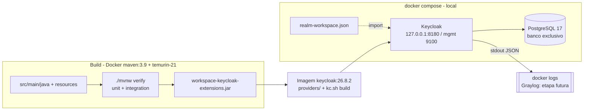

# Plano técnico — Spec 001 Keycloak customizado do Workspace

## 0. Conformidade com a Constituição

Projeto fora da stack .NET/Angular (extensões Java do Keycloak + infraestrutura Docker): aplicam-se os artigos
pertinentes (Governança). Desvio de stack registrado no ADR-0001.

| Artigo | Status | Observação |
|---|---|---|
| I — Idioma (código EN, comentários PT-BR) | ✅ | Pacotes/classes/ids de provider em inglês; Javadoc e comentários em PT-BR; mensagens do tema via `messages_pt_BR.properties` |
| II — Simplicidade / Clean Code | ✅ | Um único módulo Maven/JAR; só 2 SPIs, cada um justificado na spec; nada de framework extra |
| III — Arquitetura (dependências, banco por serviço) | ✅ | PostgreSQL exclusivo do Keycloak; lógica pura (`AuditEventMapper`) separada do adaptador SPI (DIP) |
| IV — Segurança (Keycloak, OWASP, LGPD, segredos) | ✅ | Realm endurecido (RN-05/06), `.env` gerado, portas só em `127.0.0.1`, imagens por digest, auditoria sem dado pessoal |
| V — Testes inclusos / Quality Gate | ⚠️ | Testes unitários + integração desde o 1º commit, JaCoCo ≥ 80%. **Quality Gate SonarQube pendente**: registrar o projeto exige alterar `sonarqube` (fora do escopo por decisão do responsável técnico) |
| VI — Observabilidade (logs, correlação, health) | ⚠️ | Logs JSON estruturados, `/health/live` e `/health/ready` nativos. **Envio ao Graylog pendente** (alteração no projeto `graylog`) |
| VII — Confiabilidade (timeouts, idempotência, outbox) | ✅ | Sem chamadas remotas nem mensageria nesta entrega; listener não bloqueia o login |
| VIII — Dados (migrations, expand/contract, UTC) | ✅ | Schema gerido pelas migrations do próprio Keycloak (Liquibase); nenhuma entidade JPA customizada; horários em UTC |
| IX — Contratos (OpenAPI, versão, ProblemDetails) | ✅ | Sem API própria. Contrato = formato do log de auditoria, versionado (`audit_schema=1`) |
| X/XI — Fluxo e conduta | ✅ | Spec → plano → tarefas; commits só a pedido, sem atribuição de IA |

## 1. Visão da solução

Repositório `C:\Workspace\keycloak` com **um módulo Maven** (`workspace-keycloak-extensions`) que gera um JAR com
os providers do Workspace. Um `Dockerfile` multi-stage empacota o JAR com JDK 21 (os testes rodam antes, no `scripts/build.sh`), copia-o para
`/opt/keycloak/providers` da imagem oficial `quay.io/keycloak/keycloak:26.8.2` e executa `kc.sh build`
(imagem **otimizada**). O `docker-compose.yml` sobe PostgreSQL 17 + Keycloak com `start --optimized --import-realm`,
importando o realm `workspace` versionado (sem segredos). Novos SPIs entram no mesmo módulo, como novas
`*ProviderFactory` registradas em `META-INF/services`.



## 2. Componentes afetados

| Componente | Mudança | Padrão aplicado (problema que resolve) |
|---|---|---|
| `pom.xml` | Projeto Maven, Java 21 (`maven.compiler.release=21`), BOM `keycloak-parent` 26.8.2, deps Keycloak `provided`, JUnit 5, AssertJ, Mockito, JaCoCo, Maven Wrapper | — |
| `audit/WorkspaceAuditEventListenerProviderFactory` | Factory do Event Listener SPI, id `workspace-audit` | Factory Method (contrato do SPI) |
| `audit/WorkspaceAuditEventListenerProvider` | Recebe `Event`/`AdminEvent`, delega ao mapper e escreve o log; captura falhas sem propagar (RN-03) | Adapter (isola a API interna do Keycloak) |
| `audit/AuditEventMapper` + `AuditRecord` | Função pura: evento → registro com **lista de permissão** de campos (RN-01) e nível (RN-02) | Separa regra testável do SPI |
| `audit/AuditLogWriter` | Serializa o `AuditRecord` em JSON (uma linha) via `org.jboss.logging.Logger` | Porta simples para testar o nível/conteúdo |
| `src/main/resources/theme/workspace/login/` + `META-INF/keycloak-themes.json` | Tema `workspace` (parent `keycloak.v2`), CSS, logo, `messages_pt_BR`/`messages_en` | Extensão por herança de tema (não copia templates) |
| `realm/realm-workspace.json` | Realm de dev versionado | Config as code |
| `Dockerfile`, `docker-compose.yml`, `.env.example`, `scripts/*.sh` | Build, subida, geração de `.env`, smoke test | — |

**Por que um módulo só**: dois providers pequenos no mesmo ciclo de versão; multi-módulo seria abstração antecipada (Art. II.1).

## 3. Modelo de dados

Nenhuma tabela própria. O Keycloak gerencia seu schema (Liquibase) no PostgreSQL `keycloak` exclusivo.
Volume nomeado `keycloak-db-data`. Upgrade de versão do Keycloak = nova imagem + migração automática do Keycloak,
testada localmente antes (risco R2).

## 4. Contratos

### Configuração exposta (portas só em `127.0.0.1`)

| Porta host | Container | Uso |
|---|---|---|
| 8180 | 8080 | HTTP (login, Admin Console, OIDC) — dev apenas; produção via proxy TLS (`proxy-headers=xforwarded`) |
| 9100 | 9000 | Management: `/health/live`, `/health/ready`, `/metrics` (`KC_HEALTH_ENABLED=true`, `KC_METRICS_ENABLED=true`) |

Portas 9000/9001 do host já são do Graylog/SonarQube.

### Formato do log de auditoria (contrato `audit_schema=1`)

Uma linha JSON na mensagem, categoria de logger `workspace.audit`:

```json
{"audit_schema":1,"kind":"user","type":"LOGIN_ERROR","realm_id":"…","client_id":"account-console",
 "user_id":null,"error":"invalid_user_credentials","occurred_at":"2026-11-12T13:45:10.123Z"}
```

```json
{"audit_schema":1,"kind":"admin","operation":"UPDATE","resource_type":"USER","realm_id":"…",
 "actor_user_id":"…","actor_client_id":"security-admin-console","occurred_at":"…"}
```

- Campos **proibidos** (descartados sempre): `username`, `email`, `ipAddress`, `sessionId`, `details` (exceto
  allowlist: `auth_method`, `grant_type`), `representation`, `resourcePath` (pode conter id de usuário + nomes).
- Saída do Keycloak: `KC_LOG_CONSOLE_OUTPUT=json`. Campos JSON do log de auditoria aninhados na `message`;
  extração por pipeline no Graylog fica para a etapa de integração.
- Mudança incompatível do formato → `audit_schema=2` (Art. IX.2).

### Realm `workspace` (resumo)

- `defaultLocale=pt-BR`, `supportedLocales=[pt-BR,en]`, `internationalizationEnabled=true`, `loginTheme=workspace`.
- `eventsListeners=["workspace-audit"]` (sem `jboss-logging`), `eventsEnabled=false` (não grava eventos com IP/username no banco),
  `adminEventsEnabled=true` só para o listener, `adminEventsDetailsEnabled=false`, `enabledEventTypes` com LOGIN, LOGIN_ERROR,
  LOGOUT, LOGOUT_ERROR, CODE_TO_TOKEN_ERROR, UPDATE_PASSWORD, UPDATE_PASSWORD_ERROR, REGISTER, REGISTER_ERROR, CLIENT_LOGIN_ERROR.
  *(Verificado na T04: listeners recebem eventos com `eventsEnabled=false`.)*
- `bruteForceProtected=true` (5 falhas, espera progressiva), `passwordPolicy` (length(12), digits, upperCase, lowerCase, specialChars, notUsername, notEmail, passwordHistory(5)).
- Client policy `any-client` com executor `pkce-enforcer` (S256); `admin-cli` sem Direct Access Grants (o padrão do Keycloak permite password grant nele); Implicit desabilitado.
- Tokens: access 10 min, SSO idle 30 min; refresh token rotation (`revokeRefreshToken=true`).
- Sem usuários e sem clients de aplicação no export (clients nascem com cada aplicação).

## 5. Segurança

- **Admin inicial**: `KC_BOOTSTRAP_ADMIN_USERNAME`/`KC_BOOTSTRAP_ADMIN_PASSWORD` do `.env` (gerado por `scripts/generate-env.sh`
  com senha aleatória); é um admin **temporário** do realm `master`, a ser substituído por um admin permanente com MFA (README).
- **Segredos**: `.env` no `.gitignore`; `.env.example` só com chaves vazias; senha do PostgreSQL também gerada.
- **Superfície**: HTTP e management publicados só em `127.0.0.1`; PostgreSQL sem porta publicada.
- **Supply chain (A03)**: imagens por tag + digest; Maven Wrapper com `distributionSha256Sum`; dependências via BOM do Keycloak;
  `dependency-check`/`mvn versions` revisados na T01; JAR sem dependências de terceiros embutidas (classloader compartilhado do Keycloak).
- **STRIDE resumido**:
  - *Spoofing*: força bruta → brute force detection + política de senha.
  - *Tampering*: imagem/JAR adulterado → digest fixo, build reprodutível.
  - *Repudiation*: ações sem rastro → auditoria de login e admin events (US-02).
  - *Information disclosure*: dado pessoal em log/banco → allowlist (RN-01), `eventsEnabled=false`, sem `jboss-logging`.
  - *DoS*: listener lento travando login → processamento em memória, sem I/O remoto.
  - *Elevation*: Admin Console exposto → só `127.0.0.1`; realm de aplicações separado do `master`.

## 6. Observabilidade

- Logs: JSON no stdout do container (`KC_LOG_CONSOLE_OUTPUT=json`), categoria `workspace.audit` em INFO/WARN/ERROR (RN-02).
- Health: `/health/live` e `/health/ready` nativos na porta de management (usados no `healthcheck` do compose).
- Métricas: `/metrics` (Prometheus) nativo habilitado.
- Pendente (fora do escopo): `docker-compose.graylog.yml` com GELF driver (tag `keycloak`), stream e alertas
  (rajada de `LOGIN_ERROR`, erros do listener) no projeto `graylog`.

## 7. Estratégia de testes

Ferramentas: **JUnit 5 + AssertJ + Mockito** (unitário), **keycloak-test-framework** 26.8.x (`@KeycloakIntegrationTest`,
`dependencyCurrentProject()`) para integração, JaCoCo para cobertura, `scripts/smoke-test.sh` para o ambiente Docker.

| Cenário (US/RN) | Unitário | Integração (test-framework) | Smoke (compose) |
|---|---|---|---|
| US-02 LOGIN → INFO, só campos permitidos | ✅ mapper/writer | ✅ provider registrado e invocado | ✅ log `workspace.audit` aparece |
| US-02 LOGIN_ERROR → WARN, sem username | ✅ | | ✅ login inválido via formulário |
| US-02 admin event sem representation | ✅ | | |
| US-02 falha interna não interrompe login (RN-03) | ✅ (mapper lança → ERROR, sem propagar) | | |
| US-03 tema aplicado e PT-BR padrão | ✅ chaves de `messages_*` completas | ✅ página de login contém marcador do tema | ✅ |
| US-03 realm master inalterado | | ✅ | |
| US-01 health/realm/providers | | | ✅ `/health/ready`, realm existe, provider na server info |
| US-01 `.env` ausente falha | | | ✅ |

## 8. Requisitos da máquina e ferramental

Levantamento em 2026-11-12:

| Item | Encontrado | Necessário | Ação |
|---|---|---|---|
| JDK | Oracle JDK **27.0.1** (único; `JAVA_HOME=...\jdk-27`) | JDK **21** para rodar os testes de integração (o test-framework sobe o Keycloak na JVM local, e o Keycloak 26.8 roda em OpenJDK 21) | **Padrão: nada a instalar**, build/testes rodam no container `maven:3.9-eclipse-temurin-21`. Opcional (IDE/debug): `winget install EclipseAdoptium.Temurin.21.JDK` + `~/.m2/toolchains.xml`, **sem mudar o `JAVA_HOME`** |
| Maven | não instalado | 3.9.x | **Nada a instalar**: Maven Wrapper (`mvnw`) versionado no projeto |
| Docker | Docker Desktop 29.9.3, 8 CPUs, 15,6 GB | ≥ 4 GB livres (Keycloak + PostgreSQL ≈ 1,5 GB) | OK. Com Graylog + SonarQube juntos, ~8–10 GB: dentro do limite |
| Git | 2.56.1 | qualquer recente | OK |
| Disco | 298 GB livres | ~3 GB (imagens + cache Maven) | OK |
| VS Code (opcional) | — | Extension Pack for Java + JDK 21 configurado em `java.configuration.runtimes` | Só se for depurar no editor |

Observações:
- Compilar com o JDK 27 local usando `--release 21` funciona, mas **testes de integração locais com JDK 27 não são suportados**
  pelo Keycloak; por isso o comando oficial do projeto (`scripts/build.sh`) usa o container JDK 21.
- Cache do Maven em volume Docker nomeado (`keycloak-m2`) para não baixar dependências a cada build.

## 9. Riscos

| Risco | Prob. | Impacto | Mitigação |
|---|---|---|---|
| R1 — Event Listener/Theme SPI são internos e podem mudar entre versões do Keycloak | Média | Médio | Versão fixada (26.8.2); testes de integração com a versão alvo; upgrade sempre com spec/PR próprio |
| R2 — Upgrade do Keycloak migra o schema do banco sem volta | Baixa | Alto | Backup do volume antes de upgrade; testar em volume descartável |
| R3 — Listener lança exceção e quebra login | Baixa | Alto | `try/catch` no provider, log ERROR único, testes de RN-03 |
| R4 — Dado pessoal vazar por campo novo do Keycloak | Média | Alto | Allowlist (não blocklist) + teste que falha se aparecer campo fora da lista |
| R5 — Sem Quality Gate/Graylog nesta etapa | Certa | Médio | JaCoCo ≥ 80% como gate local no `mvn verify`; integração planejada como pendência explícita |
| R6 — test-framework do Keycloak é novo (API pode mudar) | Média | Baixo | Isolado nos testes de integração; versão casada com o servidor |
| R7 — `eventsEnabled=false` impedir entrega ao listener | — | — | **Descartado**: `WorkspaceAuditEventListenerIT` comprova a entrega |

## 10. Decisões (ADRs)

- **ADR-0001**: Extensões do Keycloak em Java 21 + Maven, build/testes em container — *Proposto*
- **ADR-0002**: Auditoria de eventos do Keycloak sem dados pessoais (listener próprio com allowlist) — *Proposto*
